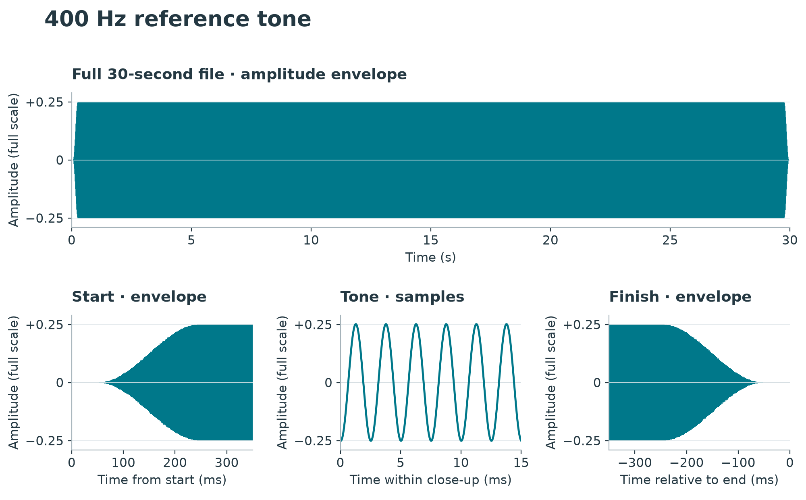
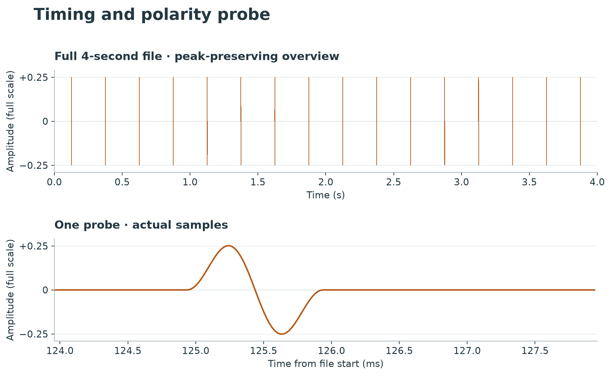
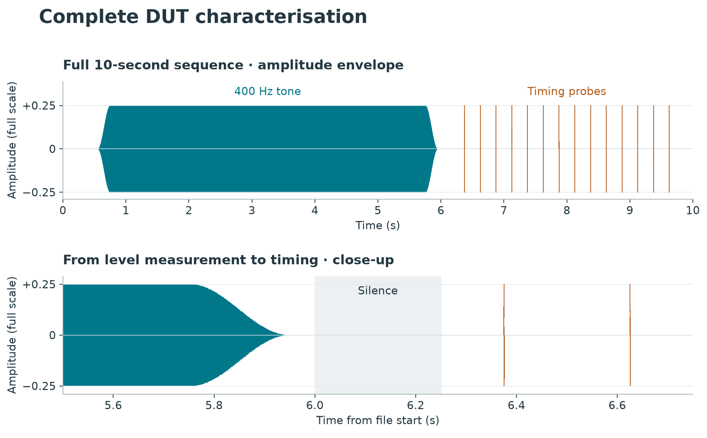

# Audio reference signals

Ready-to-play WAV files for checking audio levels, distortion, relative delay and
polarity. Download a signal below, or use the included recordings, recipes and
scripts to reproduce it. No ABX controller or other project-specific hardware is
needed to use these files.

## Download

<!-- BEGIN SIGNAL DOWNLOADS -->

| Signal | Duration | Stereo | 8-channel |
|---|---:|---|---|
| 400 Hz reference tone | 30 s | [Download WAV](https://github.com/mattclarkdotnet/abx-reference-signals/releases/download/reference-v0.1.0/reference-400hz-2ch-48k-v0.1.0.wav) | [Download WAV](https://github.com/mattclarkdotnet/abx-reference-signals/releases/download/reference-v0.1.0/reference-400hz-8ch-48k-v0.1.0.wav) |
| Timing and polarity probe | 4 s | [Download WAV](https://github.com/mattclarkdotnet/abx-reference-signals/releases/download/reference-v0.1.0/timing-probe-2ch-48k-v0.1.0.wav) | [Download WAV](https://github.com/mattclarkdotnet/abx-reference-signals/releases/download/reference-v0.1.0/timing-probe-8ch-48k-v0.1.0.wav) |
| Complete characterisation sequence | 10 s | [Download WAV](https://github.com/mattclarkdotnet/abx-reference-signals/releases/download/reference-v0.1.0/complete-characterisation-2ch-48k-v0.1.0.wav) | [Download WAV](https://github.com/mattclarkdotnet/abx-reference-signals/releases/download/reference-v0.1.0/complete-characterisation-8ch-48k-v0.1.0.wav) |

<!-- END SIGNAL DOWNLOADS -->

All downloads are **48 kHz, 24-bit PCM WAV**, with a peak level of **−12 dBFS**.
Choose **stereo** for ordinary two-channel playback; choose **8-channel** when your
player and audio interface need eight channels. Every channel contains the same
signal, aligned in time. You do not need REW, BlackHole or Python to play the files.

See the [file guide](FILES.md) for exact filenames and sequence timings, or the
[release page](https://github.com/mattclarkdotnet/abx-reference-signals/releases/tag/reference-v0.1.0)
for all files and [SHA-256 checksums](SHA256SUMS).

## Waveforms

The plots show the actual published WAV samples. Each applies to both channel
variants. Amplitude is relative to digital full scale. Overview plots preserve
the minimum and maximum samples in each interval; close-ups labelled “samples”
show the individual waveform.

### 400 Hz reference tone

Use this 30-second tone to measure output voltage or compare levels and
distortion. Its smooth, bandwidth-limited start and finish avoid an abrupt step;
take measurements during the steady part of the tone.

### Timing and polarity probe

Use this four-second sequence to compare signal arrival times and polarity.
A one-millisecond, cosine-windowed 1 kHz burst repeats every 250 ms, returning to
silence between bursts. The close-up shows its positive and negative lobes.

### Complete characterisation sequence

Use this ten-second file when you want to check levels and distortion, then delay
and polarity, in one playback. It combines a shorter reference tone with the
timing probes, separated by silence. Measurement software must recognise those
sections; the file itself does not perform or report measurements.

## Using the signals

Play the downloaded WAV through the audio equipment you want to measure and
observe its output with your meter, recorder or measurement software. For an A/B
comparison, the devices under test (DUTs) need the same source arrangement used
for listening: **Play the test signal through both DUTs simultaneously.**

The digital level does not specify an analogue voltage: that depends on your
player, volume setting and audio interface. For voltage calibration, use the
meter reading. For delay and polarity comparisons, record the outputs against
the same time reference.

## Reproducing the files

There are two ways to reproduce the collection:

- **Rebuild from the included recordings:** install [uv](https://docs.astral.sh/uv/getting-started/installation/)
  and follow the [rebuild instructions](scripted/README.md). uv sets up Python and
  the required packages. REW and an audio loopback driver are not needed for this.
- **Make fresh source recordings:** also install [Room EQ Wizard (REW)](https://www.roomeqwizard.com/)
  with its API and an audio loopback driver. Follow the [REW capture instructions](rew/README.md)
  for the supplied macOS/BlackHole workflow, including installation, permissions,
  API setup and using another REW version.

### Release generation baseline

Release **v0.1.0** was generated and checked with the following environment.
These are the versions used for that release, not a requirement to install those
exact versions or downgrade an existing installation.

| Component | Release baseline |
|---|---|
| Room EQ Wizard | 5.40 Beta 101, API 0.9.0 |
| Virtual audio driver | BlackHole 2ch 0.7.1 |
| Python | CPython 3.12.11 |
| Operating system for fresh captures | macOS 27.2 |

The Python project declares Python 3.12 or newer; `.python-version` selects the
3.12 series by default. [uv.lock](uv.lock) records the package versions used for
reproduction. Other environments should be checked with the supplied
[validation tools](validation/README.md). The current fresh-capture adapter uses
macOS/CoreAudio and BlackHole 2ch; another driver or operating system needs an
appropriate capture adapter, not different playback files.

## Sources and validation

The collection includes the original recordings and the code that shapes,
combines and checks them:

- [rew/](rew/README.md): REW API scripts, recipes and unmodified source recordings.
- [scripted/](scripted/README.md): filtering, ramps, channel expansion and sequence assembly.
- [validation/](validation/README.md): numerical checks, measured results and reproduction reports.
- [catalogue.json](catalogue.json): formats, source hashes and section boundaries.

Validation measures the saved audio, including the tone's start and finish.
These checks describe the files; the performance of your playback and measurement
equipment must be established separately. See [contributor instructions](CONTRIBUTING.md)
for updating the documentation or publishing another release.

## Licence

The audio is dedicated to the public domain under [CC0 1.0](LICENSE-CC0).
Code, recipes, metadata and documentation use the [MIT licence](LICENSE-MIT).
See [LICENSE](LICENSE) for details.
